

<h1>Ishant Bhoyar</h1>
<h3>Full-stack developer building applied-AI and offline-first software</h3>

## About

I like taking a problem from idea to a working product, from the database and API to the interface people actually use. Most of my work sits in three areas: applied AI (retrieval-augmented generation and agents), software that keeps working without a network, and tools that make a daily job easier.

I study Computer Science at Sitare University (with SRMU), Lucknow, on a full scholarship, and graduate in May 2027. Since June 2026 I have been a Software Developer Intern at [GoQii](https://goqii.com/in-en), where I build real-time clinical transcription (SOAP notes and prescriptions) and a multi-tenant hospital platform.

## Projects

<table>
  <tr>
    <td width="50%" valign="top">
      <a href="https://www.alarsio.com">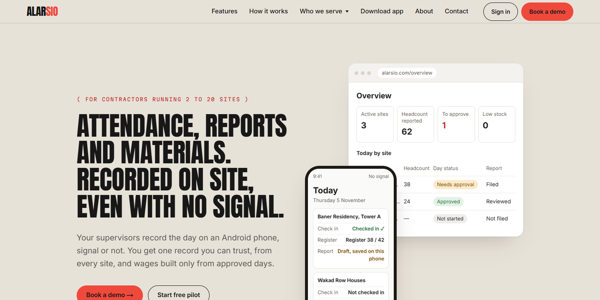</a>
       <b><a href="https://github.com/alarsio-labs/alarsio-web">Alarsio</a></b> · <a href="https://www.alarsio.com">Live</a>
       Operations platform for small Indian contractors. Site supervisors record work with no internet and it syncs later. I built identity and access, workforce and the deployment, in a team of four.
       TypeScript · Expo · Next.js · Supabase
    </td>
    <td width="50%" valign="top">
      <a href="https://goqii-transcriber-web.vercel.app/">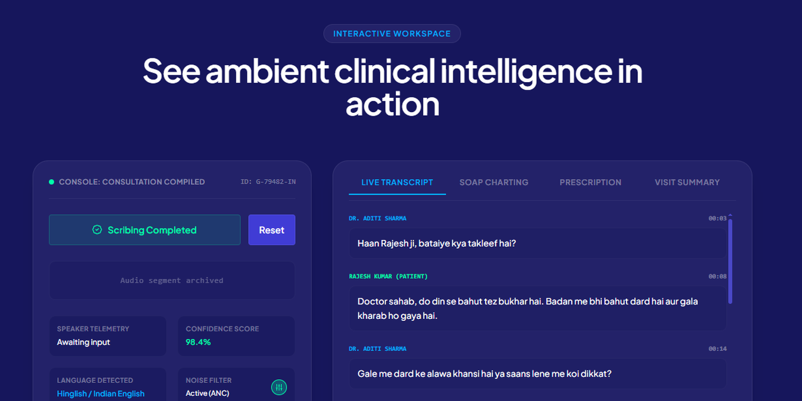</a>
       <b><a href="https://github.com/ISHANT57/Goqii-Transcriber-">Goqii Transcriber</a></b> · <a href="https://goqii-transcriber-web.vercel.app/">Live</a>
       Real-time transcription of clinical consultations that produces SOAP notes, prescriptions and a visit summary for the doctor.
       TypeScript · React · Node.js · AI
    </td>
  </tr>
  <tr>
    <td width="50%" valign="top">
      <a href="https://gitabot-hl2n.onrender.com/">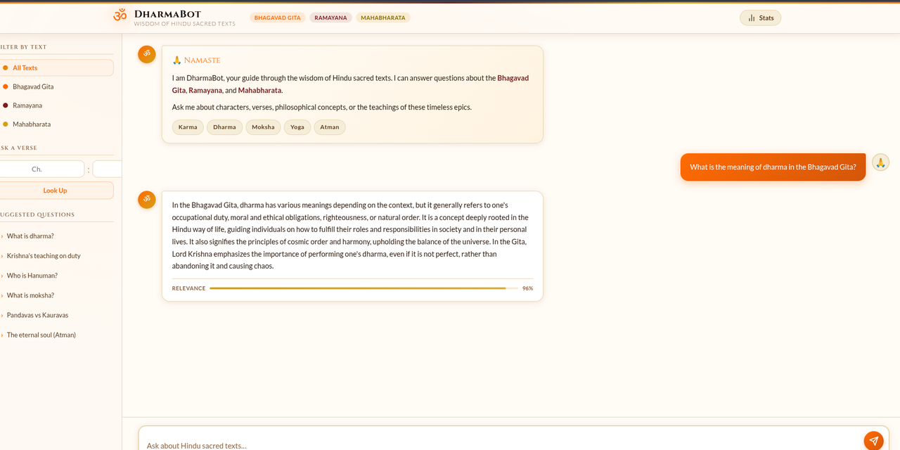</a>
       <b><a href="https://github.com/ISHANT57/Gitabot_NYD_2026">GitaBot</a></b> · <a href="https://gitabot-hl2n.onrender.com/">Live</a>
       Question answering over Hindu scriptures, using semantic search and retrieval-augmented generation. Handles many queries at once.
       Python · Mistral · Qdrant · Flask
    </td>
    <td width="50%" valign="top">
      <a href="https://github.com/ISHANT57/CareNexus">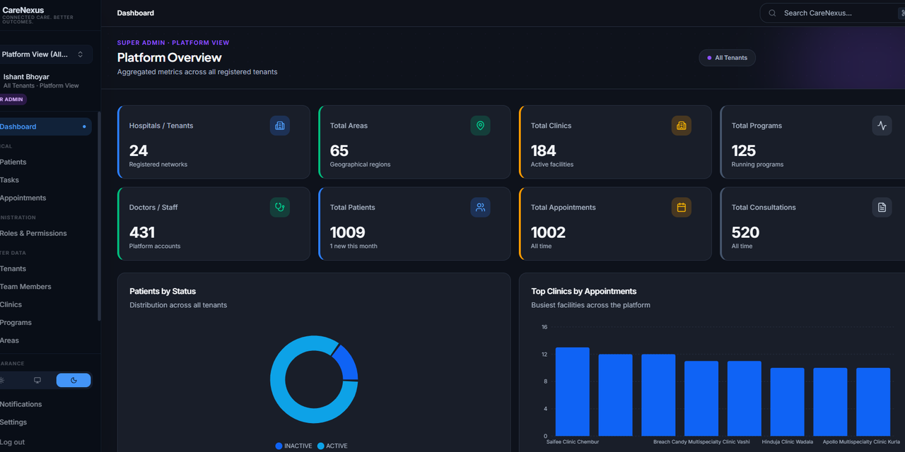</a>
       <b><a href="https://github.com/ISHANT57/CareNexus">CareNexus</a></b> · <a href="https://carenexusweb-q5ijcqplh-ishant57s-projects.vercel.app/">Live</a>
       Multi-tenant platform for hospitals and clinics: appointments, patients, staff and analytics dashboards for each tenant.
       React · Node.js · PostgreSQL
    </td>
  </tr>
  <tr>
    <td width="50%" valign="top">
      <a href="https://campus-brain-inky.vercel.app/sitare">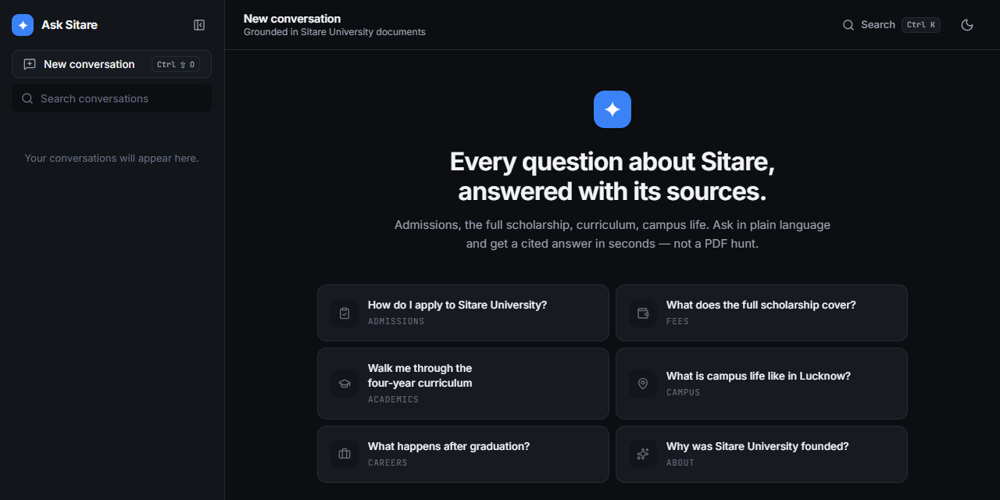</a>
       <b><a href="https://github.com/ISHANT57/CampusBrain">CampusBrain</a></b> · <a href="https://campus-brain-inky.vercel.app/sitare">Live</a>
       Answers questions about a university, grounded in its own documents, and cites the source for every answer.
       React · Node.js · RAG · Tailwind CSS
    </td>
    <td width="50%" valign="top">
      <a href="https://campus-agent-six.vercel.app/">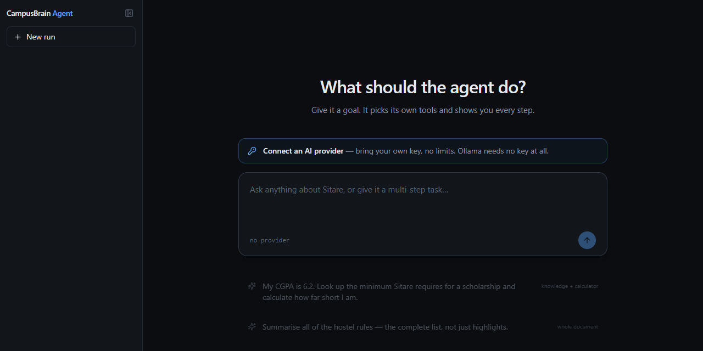</a>
       <b><a href="https://github.com/ISHANT57/CampusAgent">CampusAgent</a></b> · <a href="https://campus-agent-six.vercel.app/">Live</a>
       An agent that takes a goal, searches campus information with RAG and semantic search, and shows each step with cited sources.
       Python · Flask · RAG · Vector DB
    </td>
  </tr>
  <tr>
    <td width="50%" valign="top">
      <b>Contest Arena</b> · private repository
       Self-hosted DSA contest platform in the style of Codeforces. Submissions run in isolated Docker sandboxes against hidden tests, with a live leaderboard and 42 graph problems.
       Go · PostgreSQL · React · Docker
    </td>
    <td width="50%" valign="top">
      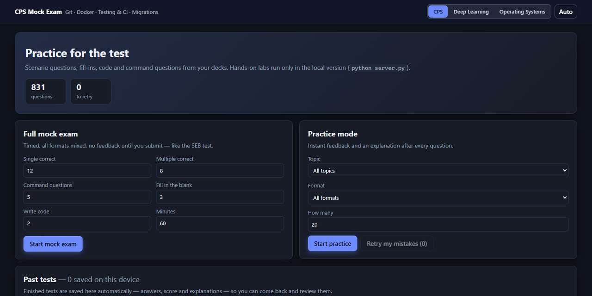
       <b>CPS Mock Exam</b> · private repository
       Practice exam platform for the CPS course (Git, Docker, shell, testing and CI). Besides questions it has hands-on labs that run real Git and Docker commands and check the result.
       Python · JavaScript · Git · Docker
    </td>
  </tr>
  <tr>
    <td width="50%" valign="top">
      <a href="https://leetcode-tracking-system-phi.vercel.app/">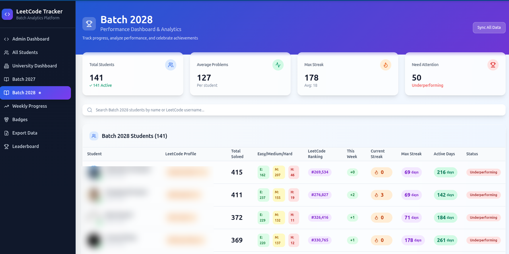</a>
       <b><a href="https://github.com/ISHANT57/LEETCODE-TRACKER">LeetCode Progress Tracker</a></b> · <a href="https://leetcode-tracking-system-phi.vercel.app/">Live</a>
       Tracks the practice of 100+ students with leaderboards, streaks and heatmaps, using GraphQL.
       React · Node.js · PostgreSQL · GraphQL
    </td>
    <td width="50%" valign="top">
      <a href="https://sitare-github-tracking-system.onrender.com">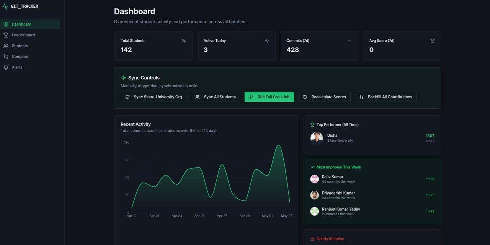</a>
       <b><a href="https://github.com/ISHANT57/Git-Tracker-">GitHub Activity Tracker</a></b> · <a href="https://sitare-github-tracking-system.onrender.com">Live</a>
       Dashboard of student GitHub activity (commits, streaks, most improved) built on the GitHub REST API, with a scheduled sync.
       React · TypeScript · GitHub API · Chart.js
    </td>
  </tr>
  <tr>
    <td width="50%" valign="top">
      <a href="https://zara-interpreter-ide-zbaf.onrender.com/">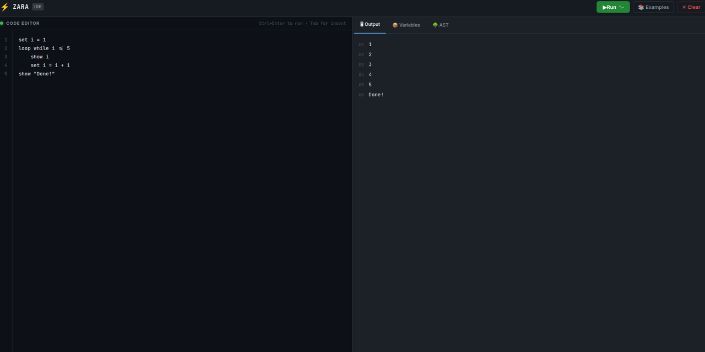</a>
       <b><a href="https://github.com/ISHANT57/Zara-Interpreter-IDE">ZARA Web IDE</a></b> · <a href="https://zara-interpreter-ide-zbaf.onrender.com/">Live</a>
       Browser IDE for the ZARA scripting language, with syntax highlighting and live execution in an output console.
       TypeScript · React · Vite
    </td>
    <td width="50%" valign="top">
      <a href="https://aqi-website-analysis-1.onrender.com/">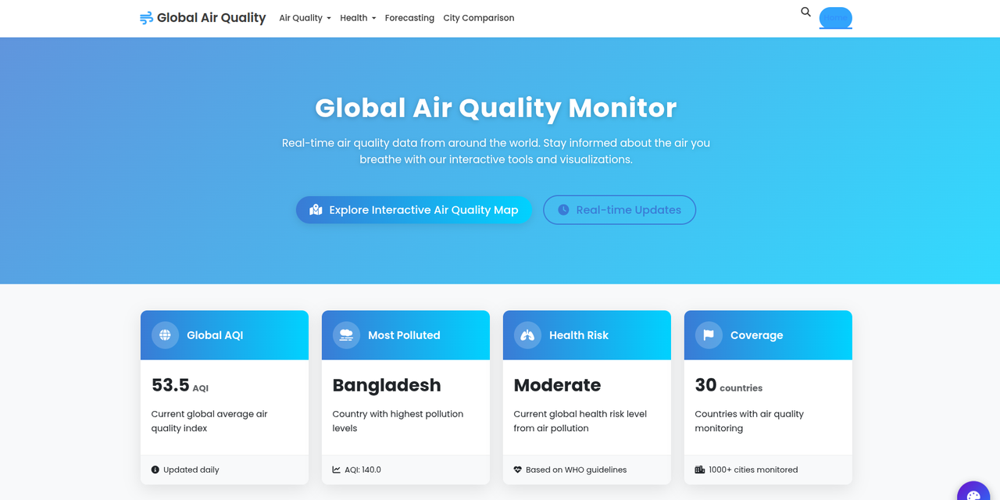</a>
       <b>AQI Analysis Platform</b> · <a href="https://aqi-website-analysis-1.onrender.com/">Live</a> · private repository
       Real-time air-quality monitoring with historical trends, interactive maps and city-by-city comparison.
       Python · Flask · Pandas · Chart.js
    </td>
  </tr>
  <tr>
    <td width="50%" valign="top">
      <a href="https://ishant57.github.io/learning-projects/">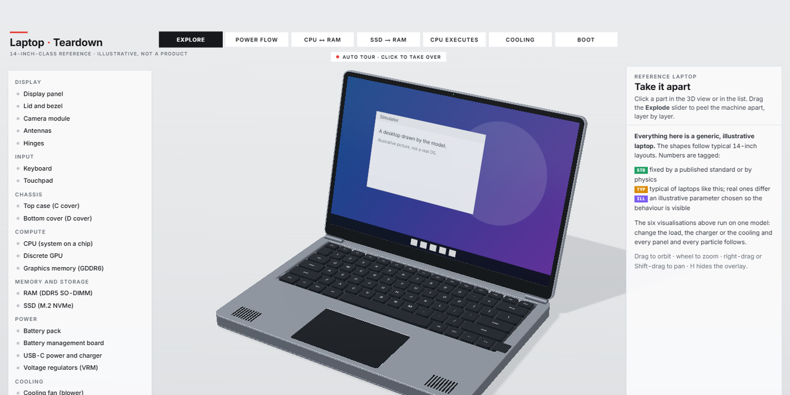</a>
       <b><a href="https://github.com/ISHANT57/learning-projects">Learning Projects</a></b> · <a href="https://ishant57.github.io/learning-projects/">Live</a>
       Small projects I build to learn new tools: an inactivity alarm for Windows, an encrypted password manager (Chrome extension), and interactive 3D laptop and phone teardowns.
       Python · TypeScript · Three.js
    </td>
    <td width="50%" valign="middle" align="center">
      <b>More work</b>
       Everything else is in my <a href="https://github.com/ISHANT57?tab=repositories">repositories</a>
       and on my <a href="https://ishant-portfolio-sxef.onrender.com">portfolio</a>.
    </td>
  </tr>
</table>

## Skills

<table>
  <tr>
    <td><b>Languages</b></td>
    <td> Also: SQL</td>
  </tr>
  <tr>
    <td><b>Web &amp; mobile</b></td>
    <td> Also: React Native (Expo)</td>
  </tr>
  <tr>
    <td><b>Data &amp; AI</b></td>
    <td> Also: Qdrant, RAG with Mistral and Gemini, agents, semantic search</td>
  </tr>
  <tr>
    <td><b>Tooling</b></td>
    <td> Also: Render, pnpm, Turborepo</td>
  </tr>
</table>

## Activity

<picture>
  <source media="(prefers-color-scheme: dark)" srcset="https://github-profile-summary-cards.vercel.app/api/cards/profile-details?username=ISHANT57&theme=tokyonight" />
  
</picture>

## Contributions

<picture>
  <source media="(prefers-color-scheme: dark)" srcset="./images/github-contribution-grid-snake-dark.svg" />
  <source media="(prefers-color-scheme: light)" srcset="./images/github-contribution-grid-snake.svg" />
  
</picture>

## Get in touch

The best way to reach me is on [LinkedIn](https://linkedin.com/in/ishant-bhoyar-555413214) or by [email](mailto:ishantbhoyar59@gmail.com).
